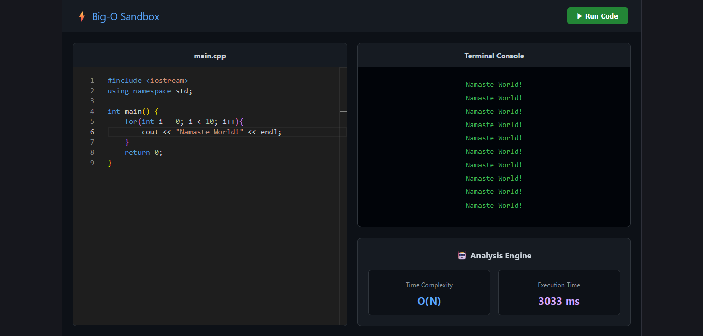

# ⚡ Distributed Code Execution Sandbox & Analysis Engine



A full-stack, distributed microservice architecture that securely executes untrusted user code (C++ & Python) in isolated ephemeral containers while predicting its Big-O Time Complexity using a machine learning worker.

## 🏗️ System Architecture & Engineering Decisions

* **Microservice Architecture:** Decoupled the Node.js API gateway from the Python ML worker to prevent heavy AST (Abstract Syntax Tree) parsing from blocking the single-threaded Node event loop.
* **Language-Agnostic Containerization (DooD):** Engineered a Docker-out-of-Docker pipeline. The system dynamically provisions specific ephemeral containers (`gcc:latest` for C++, `python:3.10-slim` for Python) based on the user's request. 
* **Secure Execution:** Uses Base64 encoding to bypass file-mounting vulnerabilities, safely compiling and executing untrusted code in isolated environments that destroy themselves immediately after execution.
* **Concurrent Orchestration:** Reduced total endpoint latency by resolving the isolated container execution and the FastAPI HTTP complexity prediction simultaneously using `Promise.all`.
* **Persistent Data Layer:** Orchestrated a PostgreSQL database with Prisma ORM, utilizing localized Docker Volumes to ensure execution logs and user states persist safely across container lifecycles.
* **Modern Frontend IDE:** Built a highly responsive Vite-React interface integrating the Monaco Editor (VS Code engine) for a native developer experience, complete with dynamic boilerplate injection and live syntax highlighting.

## 🌐 Zero-Cost Deployment Architecture

To bypass the security restrictions of standard managed hosts regarding Docker socket access (`/var/run/docker.sock`), this project utilizes a hybrid Edge/Tunnel deployment model:
* **Frontend:** Deployed globally on the **Vercel Edge Network** for sub-millisecond static asset delivery.
* **Backend:** Hosted locally and securely exposed to the public internet via **Cloudflare Tunnels (Zero Trust)**, allowing the frontend to securely invoke the Node.js Docker orchestrator without opening public ports.

## 💻 Tech Stack

* **Frontend:** React.js, Vite, Axios, Monaco Editor
* **API Gateway:** Node.js, Express.js, Prisma ORM
* **ML Microservice:** Python, FastAPI, Pydantic
* **Database:** PostgreSQL (v15)
* **Infrastructure:** Docker, Docker Compose, Cloudflare Tunnels

## 🚀 Local Setup & Installation

### 1. Prerequisites
Ensure you have the following installed on your machine:
* [Docker Desktop](https://www.docker.com/products/docker-desktop) (Running in the background)
* [Node.js](https://nodejs.org/) (v22+)
* Git

### 2. Clone the Repository
```bash
git clone [https://github.com/Varun-Pradhan06/remote-code-execution-engine.git](https://github.com/Varun-Pradhan06/remote-code-execution-engine.git)
cd remote-code-execution-engine